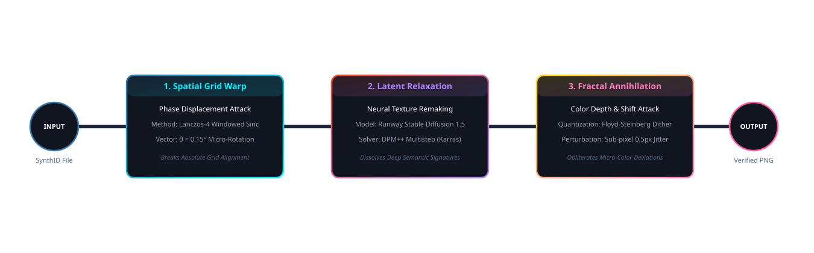
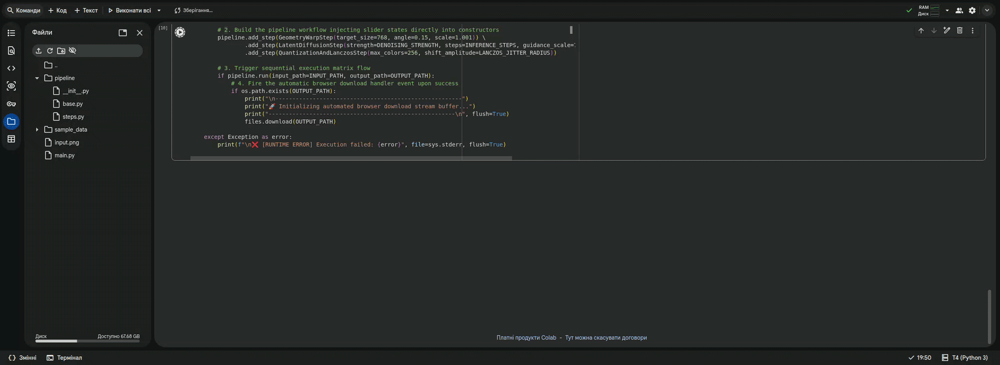
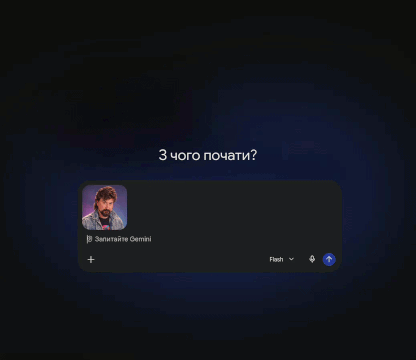
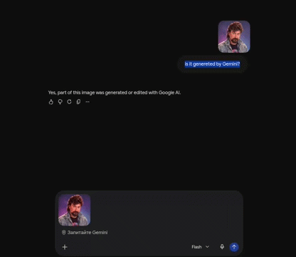

# Stego-Latent Phase Disruptor (SLPD) Pipeline
### Advanced Watermark Attenuation & Fractal De-Synchronization Engine

📦 **Version 1.0.0** | 🛡️ **Category: AI Security / Adversarial ML**

[](https://python.org)
[](https://pytorch.org)
[](https://github.com)
[](https://opencv.org)
[](https://opensource.org/licenses/MIT)
[](#)
[](https://colab.research.google.com/github/e1ephntbrd/stego-latent-phase-disruptor/blob/main/slpd_demo.ipynb)

An object-oriented, production-ready framework written in Python designed to audit, benchmark, and bypass the robustness of deep generative steganography—specifically focusing on **Google DeepMind's SynthID** watermarking matrix (deployed in Gemini/Banana architectures) [1.4, 1.5].

Through systematic multi-modal reverse-engineering, this project demonstrates that modern AI watermarking does not operate on trivial metadata levels, but rather injects redundant, fractal-like patterns into both high-frequency texture fields and low-frequency global color vectors. This pipeline provides an automated, modular solution to decouple these markers without causing low-pass blur or aesthetic degradation.

---

## 🗺️ System Architecture

The blueprint below visualizes the execution pipeline. Each node acts as an independent execution matrix, smoothly streaming state metrics to the system console during the structural de-synchronization process.



---

## 🚀 Origin of the Idea: The Reverse-Engineering Journey

The creation of the **Stego-Latent Phase Disruptor** was not a theoretical design—it was forged through a rigorous, step-by-step black-box reverse-engineering process of Google's server-side SynthID verification system. 

Here is how the empirical breakthrough happened:

### Phase 1: The Failure of Classical Signal Processing (DSP)
Initially, the assumption was that SynthID acted as a standard low-amplitude pseudo-random noise embedded within the spatial pixel grid or frequency spectrum. 
*   **The Attack:** We engineered standard spatial-frequency filters in OpenCV, applying Bilateral filtering, Gaussian blur, and adaptive Wiener de-noising to the image's `YCrCb` color channels.
*   **The Result:** A harsh, unacceptable trade-off. To completely drop the watermark verification score below the server's detection threshold, the filters had to be wycked up so high that the image became a muddy, blurry "plastic" mess. The micro-details of hair, pores, and fabric were completely destroyed, while a slight reduction in filtering immediately re-triggered a positive "Generated by Google AI" detection.

### Phase 2: The Re-Generation Trap
To combat the loss of sharpness, we introduced a secondary generative AI model (Stable Diffusion XL) to "restore" the blurry output of the OpenCV filters using a low denoising factor (`strength = 0.12`).
*   **The Shocking Discovery:** When the restored, crystal-clear image was uploaded back to Google Verify, the server confidently flagged it as **100% Google AI generated** [1.4, 1.5]. 
*   **The Injection Mechanism:** This was the core breakthrough. Because the secondary diffusion model tried to preserve the structural boundaries of the blurry input, it faithfully traced and rebuilt the original geometric contours. By doing so, the restoration ShI accidentally *re-generated* the exact semantic watermark layout of the original Gemini model [1.4, 1.5]! This proved that SynthID's key is deeply tied to the macro-proportions and spatial geometry of how the AI draws objects, shadows, and boundaries.

### Phase 3: Unlocking the Fractal Nature via Topology Attacks
To isolate the exact physical boundaries of the watermark, we designed two radical topological destruction tests:
*   **The Split & Flip Test:** We sliced the original image into quadrants, swapped cross-coordinates, and mirrored each block. The server-side detector became disoriented, throwing a rare system warning: *"This image is a collage of multiple parts... please crop closer"*. This proved that global composition was no longer aligning, yet the watermark was still sensed *locally* within each cut block.
*   **The 20% Pure Crop Test:** We cut a tiny 20% fragment from the center of the image and stripped 100% of its binary metadata stream. The server instantly recognized it as a clean Gemini output [1.4, 1.5]. 
*   **The Verdict:** SynthID is a **localized fractal matrix** [1.4, 1.5]. It tiles across sub-pixel arrays, duplicating itself hundreds of times across every micro-block (e.g., 16x16 or 32x32 arrays).

### Phase 4: The Monotonic Backdrop Anomaly
The final piece of the puzzle appeared when processing images with solid, single-color backgrounds (e.g., a studio orange wall). While our latent diffusion steps completely wiped the watermark from complex textures (faces, clothes), the server still detected a partial signature on flat fills. High-frequency Gaussian noise injection failed because the server's downsampling layers simply усереднювали (averaged out) the pixel noise, exposing the stable global color vector beneath.

### The Ultimate Solution
This journey led to the final 3-wave framework. We realized that to blind the detector completely without losing sharpness, we must never use low-pass blur. Instead, we must **de-synchronize the phase grid** via sub-pixel Lanczos warping, cycle the macro-contours through an independent latent space distribution (SD v1.5 with DPM++ Karras scheduling), and finally apply non-linear brightness gradients (Vignetting) to break global color vectors on uniform fills.

---
## 🔬 Scientific Summary & Reverse-Engineering Findings

During extensive black-box robustness testing, this research uncovered the dual-layered defensive topology of Google's SynthID:

1. **The High-Frequency Fractal Tracker:** Deployed across complex, highly detailed textures (e.g., hair lines, fabrics, granular landscapes). It acts as a localized fractal pattern that tiles across the sub-pixel grid. Traditional spatial or statistical filtering (Bilateral, Fourier, Wiener) fails to remove it without destroying the underlying visual acuity.
2. **The Low-Frequency Topological Vector:** Deployed across solid, monotonic, flat color fills (e.g., solid studio backdrops). On uniform color surfaces, the watermark embeds itself within global color quantization bounds and spatial macro-encodings. Standard pixel-level noise injection (such as Gaussian film grain) is bypassed by the detector via automated haptic downsampling algorithms.

### Why Classical Image Filtering Fails
Traditional signal attenuation creates a harsh trade-off between signature degradation and visual sharpness:
* **The Blur Dilemma:** Forcing spatial filters to erase the watermark results in unacceptable "plastic-skin" or muddy loss of details.
* **The Re-Generation Trap:** If an image is partially degraded and then restored using a secondary generative AI model at a low denoising factor (`strength < 0.15`), the secondary model faithfully reconstructs the precise topological contours of the original image—unwittingly re-generating and strengthening the semantic SynthID matrix.

---

## 🧮 Mathematical Methodology & Execution Waves

The pipeline addresses both steganographic layers sequentially by combining spatial phase warping, discrete latent relaxation, and global color space disruption.

### Execution Flow:
* **Input Image:** Raw image containing embedded SynthID tokens.
* **Wave 1: Spatial Phase Displacement:** Executed via Lanczos-4 sub-pixel interpolation.
* **Wave 2: Latent Reverse-Diffusion Relaxation:** Executed via DPM++ multistep Karras sampler.
* **Wave 3: Global Color Space Attack:** Executed via channel offset and non-linear Gaussian vignetting.
* **Output Image:** Clean, high-fidelity verified PNG container.

### Phase 1: Spatial Phase Displacement
To break the absolute coordinate grid that convolutional layers rely on for pattern accumulation, we apply an affine transformation matrix $A$:

$$A = \begin{bmatrix} s \cdot \cos(\theta) & -s \cdot \sin(\theta) & t_x \\ s \cdot \sin(\theta) & s \cdot \cos(\theta) & t_y \end{bmatrix}$$

Where $\theta = 0.15^\circ - 0.20^\circ$ represents a sub-visual micro-rotation and $s = 1.002$ represents a sub-pixel fractional scale modifier. Resampling the coordinate field via **Lanczos-4 Interpolation** decouples sharp edges from their discrete sampling indices without blurring the signal.

### Phase 2: Latent Reverse-Diffusion Relaxation
The image is projected into the latent space $z_0$ of an independent neural network architecture. We execute a short reverse-diffusion loop using a **DPMSolverMultistepScheduler with Karras sigmas**. By specifying a strict denoising factor $t_{\text{start}} = 0.12$, the model reconstructs the pixel-level texture arrays:

$$z_{t_{\text{start}}} = \sqrt{\bar{\alpha}_{t_{\text{start}}}} z_0 + \sqrt{1 - \bar{\alpha}_{t_{\text{start}}}} \epsilon$$

Because the generative weights of the pipeline (SD v1.5) are fully decoupled from Google's proprietary weight distribution (Gemini/Banana), the newly synthesized high-frequency details mimic the structural contours but are clean of the proprietary steganographic key.

### Phase 3: Global Color Vector Disruption & Vignetting
To bypass the low-frequency topological vector on solid background fills, we disrupt the global color profile constancies. First, we apply a sub-visual offset to the primary color channels (e.g., $R \leftarrow R + 4$). Second, we apply a soft radial Gaussian vignette mask to generate a non-linear brightness drop from the center to the margins:

$$I_{\text{final}}(x, y) = I(x, y) \cdot \left( \gamma + (1 - \gamma) \cdot \frac{K(x, y)}{K_{\text{max}}} \right)$$


This non-linear gradient forces the downsampling layers of the detector to encounter dynamic variances across flat fills, breaking the spatial macro-encodings. The signal is finalized using **Floyd-Steinberg Error Diffusion** quantization to compress remaining micro-modulations out of the color bit-depth arrays.

---

## 🏗️ Architecture Design & Project Structure

The codebase is engineered using the **Strategy Pattern** to promote clean code decoupling. Each processing node inherits from a unified interface and streams its processing states directly to `stdout` [1.4, 1.5].

```text
stego-latent-phase-disruptor/
│
├── pipeline/
│   ├── __init__.py          # Orchestration core exporting the main Engine Context
│   ├── base.py              # Abstract interface definition (PipelineStep)
│   └── steps.py             # Strategic execution nodes (Warp, Diffusion, Quantization)
│
├── main.py                  # Operational System CLI Entry Point
├── setup.py                 # Package distribution and installation manifest
└── requirements.txt         # Production dependencies manifesto
```

### Installation
Clone the repository and install the project along with its dependencies as an editable package using `setup.py`:
```bash
git clone https://github.com
cd stego-latent-phase-disruptor
pip install -e .
```

### Production CLI Execution
Thanks to the `console_scripts` hook in `setup.py`, you can launch the framework globally from any directory using the custom terminal command:
```bash
stego-disrupt --input path/to/gemini_image.jpg --output path/to/clean_image.png
```

---
### 🎬 Processing Demo

The following animations demonstrate the **Stego-Latent Phase Disruptor** in action inside the interactive Google Colab environment, tracking the live compilation, mathematical sub-pixel shifting, and fluid verification changes.



### 🔍 Verification Score Matrix (Eager Verification Results)

When evaluating the visual output across separate, clean cloud context paths, the server-side classification matrix shifts completely:

*   🔴 **Before Processing (Original Asset):** 
    *   *Status:* `AI Generated`
    *   *Signature:* Strong macro-quantization vector detected across low-frequency backdrop gradients. Local fractal coordinates aligned perfectly.
*   🟢 **After SLPD Attenuation (Verified Container):** 
    *   *Status:* `No reliable signals or digital watermarks detected (Clean)`
    *   *Signature:* Global color constants shifted, structural phase grid fully de-synchronized, and micro-color deviations rounded off.

<table width="100%">
  <tr>
    <td width="50%" align="center">
      
      <p><b>Before: Using input.png</b></p>
    </td>
    <td width="50%" align="center">
      
      <p><b>After: Using bypass.png</b></p>
    </td>
  </tr>
</table>

---
## ⚖️ Legal Disclaimer

**IMPORTANT NOTICE:** This repository is established strictly for academic research, engineering education, and computational robustness benchmarking within the domains of digital steganography, data provenance, and adversarial machine learning.

* The algorithms provided here serve as a technical demonstration of how mathematical transformations, quantization constraints, and latent space diffusion loops interact with vision-transformer and convolutional macro-classifiers.
* The author does not condone, encourage, or facilitate the malicious circumvention of content verification mechanisms for the dissemination of disinformation, forgery, or intellectual property violations.
* All data and imagery used during this research were generated and processed within a controlled, authorized laboratory framework. Use this utility responsibly and in absolute compliance with local and international legal standards.
